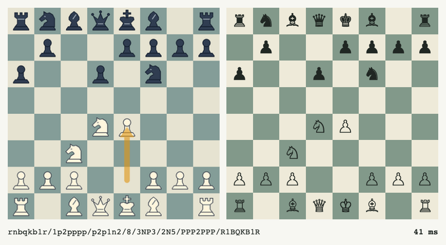
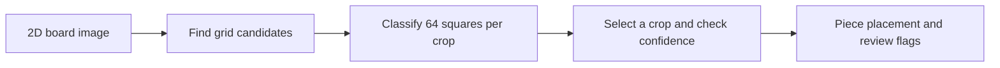
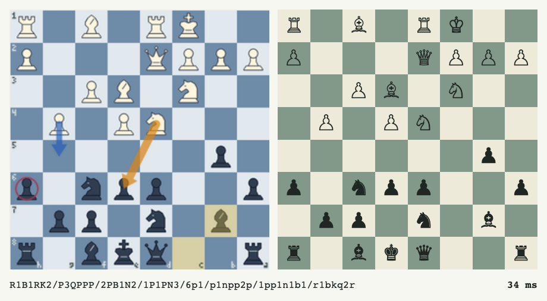

# StudyChess OCR for 2D boards

Read a chess position from a screenshot in the browser. StudyChess OCR locates one 8×8 board and returns the piece placement in the image’s visual order, with confidence scores and review flags. Inference runs locally on the CPU using WebAssembly. [ONNX Runtime Web](https://onnxruntime.ai/docs/tutorials/web/)

**Bring a compatible ONNX classifier to run the demo.** [Model interface](MODEL.md)



The input crop is on the left and the reconstructed board is on the right. Times show median submission-to-result latency over seven reads in Chromium on an Apple M1 Pro with the model already loaded.

## Run the demo

Use Node.js 22.15 or newer with Corepack.

```sh
git clone --depth 1 https://github.com/infcodev/StudyChess-OCR-2dboard.git
cd StudyChess-OCR-2dboard
corepack pnpm install --frozen-lockfile --ignore-scripts
corepack pnpm demo
```

Open the local URL printed by Vite. Choose your ONNX model and a PNG, JPEG, or WebP screenshot, then select **Leer tablero**. The demo shows the selected crop and the reconstructed board. Select **Copiar colocación** to copy the FEN piece placement. The model and screenshot stay in your browser.

## How it works



1. **Prepare the image for detection.** The reader takes an RGBA image and creates a grayscale copy for geometry. If its longest edge exceeds 1,600 pixels, it scales the grayscale copy down to that limit. The original pixels remain available for classification. [Raster preprocessing](src/raster.js)
2. **Find candidate grids.** The detector looks for evenly spaced peaks in horizontal and vertical image gradients and scores candidate regions against a checkerboard. It compares the initial crop with a grid-snapped variant that shifts the crop to improve alignment. When the first pass is inconclusive, it also searches blurred copies for plausible grids. This geometry is adapted from Fenshot 0.1.6, whose detector derives from TensorFlow Chessbot. [Fenshot](https://github.com/scoriiu/fenshot) · [TensorFlow Chessbot](https://github.com/Elucidation/tensorflow_chessbot) · [Geometry attribution](src/geometry/README.md)
3. **Classify all 64 squares in one batch per crop.** Each crop maps back to the original image. The reader divides it into an 8×8 grid, resizes each square to 32×32 RGB pixels, and passes a `float32[64, 32, 32, 3]` tensor to the ONNX model. The model returns 13 scores per square for the empty class and six piece types per color, in the order `.PNBRQKpnbrqk`. [Tile preprocessing](src/tiles.js) · [Model interface](MODEL.md)
4. **Select a crop and assess the reading.** The geometry code ranks candidate crops by mean square confidence. The initial search can settle on a crop when every square scores at least 0.70, the placement contains one king of each color, and the crop’s checkerboard structure scores at least 0.80. After the fallback search, a different placement within 0.03 of the winning mean makes the result contested. If a placement fails the king count, the detector can mask the region and scan again for a more plausible candidate. [Crop selection](src/geometry/index.js)

## Read the result

| Status | Meaning |
| --- | --- |
| `ok` | The reading passed the geometry, king-count, and square-confidence checks. |
| `needs_review` | The reader found a crop and flagged the reading. Inspect `reviewReasons` and any indices in `reviewSquares`. |
| `no_board` | The detector returned no usable crop. |

The reader flags any square below 0.85 confidence. A failed king count or unreliable crop also triggers review. If the reading otherwise passes, the reader flags a piece when a crop with each edge within one-sixteenth of a square predicts the same piece with a score at least 0.25 lower. These checks can catch some alignment and classification problems. A reading can still pass with incorrect pieces. [Review logic](src/index.js) · [Crop selection](src/geometry/index.js)

The detector expects an axis-aligned 2D board and returns at most one reading per image. Overlays can hide piece details, and low contrast or textures can shift the detected grid. [Board detector](src/geometry/detect.js)

### Placement and square indices

The string shown under the reconstructed board is `placement`, the piece-placement field of FEN. Rows are read from top to bottom and squares from left to right. `reviewSquares` uses the same order, with index `0` at the top-left corner.

The app or user confirms the orientation and side to move and supplies castling rights, the en passant square, and move counters if a full FEN is needed. [Result type](src/index.d.ts) · [Demo worker](demo/ocr-worker.js)

### Annotated board with Black at the bottom



The second example uses a 264×264 pixel board inside a larger synthetic screenshot. The reader matched all 64 squares and kept the visual orientation of the input.

## How the reference classifier was developed

We trained a convolutional tile classifier in Keras using square labels from known board positions, then fine-tuned it with more piece styles, annotated boards, and printed diagrams. The evaluation checked entire board placements as well as mistakes that passed the confidence checks. We exported the reference model to ONNX for browser inference. The demo accepts any classifier that implements the documented model interface. [Model interface](MODEL.md)

- **Procedural positions and annotated renders.** Generated boards supplied exact square labels in both orientations. Rendered variants added arrows, circles, coordinates, and highlights over occupied and empty squares. Variants of the same position stayed together when splitting the generated corpus.
- **Lichess Open Database and artwork.** The puzzle export supplied positions and moves for locally rendered boards. Some renders used the Chessnut, Fantasy, and RhosGFX piece sets, each with its own asset license. [Lichess puzzle export](https://database.lichess.org/#puzzles) · [Lichess asset licenses](https://github.com/lichess-org/lila/blob/master/COPYING.md)
- **Chess Positions on Kaggle.** Training used images from this dataset to broaden the variety of board and piece styles. The dataset mirror attributes the board and piece artwork to Chess.com. [Chess Positions](https://www.kaggle.com/datasets/koryakinp/chess-positions) · [Dataset mirror and attribution](https://huggingface.co/datasets/smallchess/kaggle-chess-positions#source--attribution)
- **Printed and scanned diagrams.** Experiments used cropped diagrams from chess books and tournament bulletins to cover different hatching and print quality. The positions were checked against game records or printed move sequences. [BritBase Chess Library](https://www.rgs.saund.co.uk/britbase/britbasedocuments.html)

Both examples use original project artwork. The reference weights, training datasets, and evaluation reports are outside this release.

## License

The reader and demo code are MIT licensed. The board geometry includes code from Fenshot and TensorFlow Chessbot under their MIT notices. See the [project license](LICENSE) and [geometry attribution](src/geometry/README.md).
